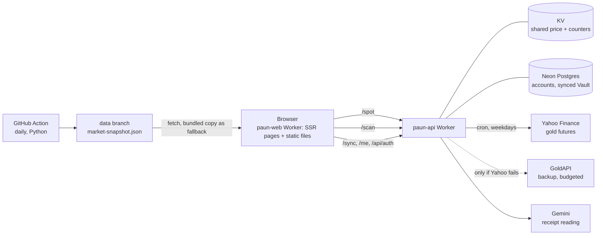

<p align="center">
  
</p>

<h1 align="center">Paun</h1>

<p align="center"><b>A bilingual (English / Bahasa Melayu) gold assistant for people who buy, hold and sell physical gold jewellery in Malaysia.</b></p>

| | |
|---|---|
| **Live site** | <https://paun-web.paun-gold.workers.dev> |
| **Stack** | TanStack Start (React 19) · Tailwind CSS v4 · Cloudflare Workers · Neon Postgres · Vitest |
| **Plan** | [`PLAN.md`](PLAN.md): what Paun is for and what is being built next |

Paun (பவுன், Tamil for a gold weight of about 8 g) runs in the browser with no login. Prices and fees in the app are indicative
defaults the user can edit; nothing here is financial advice.

---

## Contents

- [What it is for](#what-it-is-for)
- [Features](#features)
- [How it works](#how-it-works)
  - [The pieces](#the-pieces)
  - [Scanning a receipt](#scanning-a-receipt)
- [Tech stack](#tech-stack)
- [Development](#development)
  - [Commands](#commands)
  - [Environment variables](#environment-variables)
  - [Tests](#tests)
- [Deployment](#deployment)
- [Project structure](#project-structure)
- [Privacy and security](#privacy-and-security)
- [Limitations and roadmap](#limitations-and-roadmap)
- [Issues and credits](#issues-and-credits)

## What it is for

Four questions, in RM, at home or at the jewellery counter:

1. What is gold worth today?
2. Is this shop's price fair, and am I paying for gold or for workmanship (*upah*)?
3. What should I get if I sell or trade in (*susut*, buy-back rate)?
4. What is my gold worth now?

The app grew past these into trader features; [`PLAN.md`](PLAN.md) records the refocus and the phases that bring it back.

## Features

| Feature | What it does |
|---|---|
| **Landing** (`/`) | Interactive globe of gold prices by country; the shared near-live gold price with its time and source |
| **Calculator** (`/dashboard`) | Buy vs sell / trade-in: weight, purity, making fee, melting deduction, duty and tax; a verdict on the asking price |
| **Markets** (`/markets`) | Real daily price history and a plain-language **price-range forecast** for the coming week; cost per gram by country |
| **Arbitrage** (`/arbitrage`) | The same purchase compared across countries |
| **Monthly plan** (`/dca`) | A backtest of buying gold every month against a savings account, on real price history |
| **Vault** (`/vault`) | Your pieces with value, profit and loss; JSON export and import; **receipt scanner** (Beta) |
| **Gold Guide** | Bilingual explainer: how a jewellery price is built, *upah*, melting deductions, purity, the *paun* unit |
| **Simple / Pro** | Simple shows the answer; Pro shows the workings and the editable defaults |
| **Optional sign-in** | Google sign-in keeps the Vault, preferences and watchlist in step across devices; hidden behind `?accounts=1` while it is tested |
| **Installable** | Web app manifest, so it can be added to a phone's home screen; online only |

## How it works

All gold maths is in USD inside the browser and only the display converts to the chosen currency. App state is LocalStorage
(`src/lib/gold-store.tsx`); the backend exists only for the shared price, the receipt scanner and the optional account.



### The pieces

| Piece | Runs in | Job |
|---|---|---|
| Front end (`src/`) | Cloudflare Worker `paun-web` | Server-rendered pages, calculators, Vault, guide |
| Backend (`workers/paun-api/`) | Cloudflare Worker `paun-api` | `GET /spot`, `POST /scan`, `POST /sync`, `GET`/`DELETE /me`, `/api/auth/*`, `GET /health`; a cron every 15 minutes on weekdays |
| Daily snapshot (`ml/`, `.github/workflows/market-snapshot.yml`) | GitHub Actions, Python 3.12 | Publishes `market-snapshot.json` to the `data` branch: real daily closes, exchange rates and the forecast inputs |
| Forecast (`src/lib/forecast/`) | The browser | TypeScript port of the Python features and volatility bands, parity-tested against the snapshot file |

The forecast shows a likely price range, not a direction: the regime (bearish / sideways / bullish) model did not pass its own
ship rules, so its probabilities are hidden (`ml/README.md`).

### Scanning a receipt

```mermaid
sequenceDiagram
  participant U as Person
  participant B as Browser
  participant W as paun-api Worker
  participant G as Gemini
  U->>B: Choose a photo of a receipt
  B->>B: Resize to about 1280 px JPEG
  B->>W: POST /scan (photo, Turnstile token)
  W->>W: Check origin, Turnstile, per-visitor and daily limits
  W->>G: Read the photo into structured fields
  G-->>W: Pieces, weights, purity, upah, date, total
  W->>W: Validate every field, null if unsure
  W-->>B: Fields only (the photo is never stored)
  B-->>U: Review panel; nothing is saved until you confirm
```

## Tech stack

| Layer | Choice | Why |
|---|---|---|
| Front end | TanStack Start, React 19, Vite 8 | Server-rendered pages with file-based routing |
| Styling | Tailwind CSS v4, shadcn / Radix UI | Accessible primitives, one design token set |
| Charts | Recharts | Small, React-native price and comparison charts |
| Copy | i18next, bundled `en.json` and `ms.json` | Bilingual and available offline once loaded; trade words are not machine-translated |
| Hosting | Cloudflare Workers with static assets (Nitro preset `cloudflare-module`) | One platform for the site, the API, cron and KV |
| Backend data | Cloudflare KV, Neon Postgres | KV for the shared price; Postgres only for the optional account |
| Auth | Better Auth inside the Worker, Google ID token | Runs where the other backend code runs; no cookies, so Safari and Chrome third-party blocking does not matter |
| Receipt reading | Gemini structured output, Cloudflare Turnstile | Vision model with a fixed schema; Turnstile against abuse |
| Forecast | CatBoost and GARCH / EWMA in Python (offline), TypeScript in the browser | Heavy training stays offline; the browser only recomputes bands |
| Tests | Vitest, pytest (`ml/tests`) | Maths, sync rules and forecast parity |

## Development

Requirements: [Bun](https://bun.sh). Python 3.12 only if you work on `ml/`.

### Commands

```sh
bun install
bun run dev              # front end at http://localhost:8080
bun run dev:api          # backend Worker locally, no account needed
bun run test             # Vitest: front end and Worker
bunx tsc --noEmit        # typecheck the front end
bun run typecheck:api    # typecheck the Worker
bun run lint
bun run build            # production build into .output/
bun run preview:worker   # build and run it in the real Workers runtime
bun run deploy           # build and wrangler deploy (needs `wrangler login`)
bun run eval:scan        # score the scanner on sample photos in ./receipts-ref (needs GEMINI_API_KEY in workers/paun-api/.dev.vars)
```

### Environment variables

Front end (all optional; the defaults are the public production values):

| Name | Purpose |
|---|---|
| `VITE_PAUN_API` | Base URL of the backend Worker |
| `VITE_GOOGLE_CLIENT_ID` | Google OAuth client id used by the sign-in button (public) |
| `VITE_TURNSTILE_SITE_KEY` | Cloudflare Turnstile site key (public) |

Backend Worker (`workers/paun-api/wrangler.jsonc` for variables; `wrangler secret put <NAME>` for secrets). Values never go in the repo.

| Name | Kind | Purpose |
|---|---|---|
| `SPOT` | KV binding | The latest shared price and the GoldAPI call counters |
| `GOLDAPI_KEY` | Secret | Backup price source, used only when Yahoo fails |
| `MONTHLY_BUDGET`, `DAILY_BUDGET` | Variable | Hard caps on GoldAPI calls (90 a month, 3 a day) |
| `GEMINI_API_KEY`, `TURNSTILE_SECRET` | Secret | Receipt scanner; without both, `/scan` answers `503 scanner_not_configured` |
| `GEMINI_MODEL`, `SCAN_DAILY_CAP`, `SCAN_PER_VISITOR_HOUR` | Variable | Scanner model and limits |
| `DATABASE_URL`, `BETTER_AUTH_SECRET`, `GOOGLE_CLIENT_SECRET` | Secret | Optional accounts |
| `GOOGLE_CLIENT_ID`, `BETTER_AUTH_URL` | Variable | Optional accounts (public values) |
| `EXTRA_ORIGINS` | Variable | Extra browser origins allowed to call the API, such as a custom domain |

### Tests

`bun run test` runs 556 tests in 21 files (258 of them in the Worker), covering the money maths, Vault import, sync merge rules, the
forecast parity against `public/data/market-snapshot.json`, and the Worker's limits and validation. A rule in `datetime.test.ts` fails
if a component formats a date itself. The Python side runs with `pytest ml/tests`. GitHub Actions runs the checks on every pull
request (`.github/workflows/ci.yml`).

## Deployment

Pushes to `main` are built and deployed by Cloudflare automatically (Worker `paun-web`). The backend is a second Worker with its own
config and deploys (`bun run deploy:api`, root directory `workers/paun-api`). Database migrations are in
`workers/paun-api/migrations/`. The snapshot job commits only to the `data` branch. Step by step, including the one-time dashboard
setup and secrets: [`docs/deploy.md`](docs/deploy.md).

## Project structure

```
src/
  routes/            pages (file-based routing)
  components/gold/   app components: calculators, charts, Vault, scanner, guide
  components/ui/     shadcn / Radix primitives
  lib/               pricing maths (gold.ts), state (gold-store.tsx), sync, scanner client, dates
  lib/forecast/      snapshot loader, features and volatility bands (TypeScript port)
  locales/           en.json, ms.json
public/              icons, manifest, bundled snapshot, model files
workers/paun-api/    backend Worker: spot feed, scanner, accounts, sync
  migrations/        SQL for the account and sync tables
  eval/              scanner accuracy runner
ml/                  Python training, evaluation and the daily snapshot job
docs/                deploy guide, archived plans
.github/workflows/   CI and the daily snapshot
PLAN.md              what Paun is for, decisions, phases
AGENTS.md            rules for contributors and coding agents
```

## Privacy and security

- **On your device:** settings and the Vault live in your browser's storage. No account is needed for anything.
- **If you sign in with Google** (optional): Paun keeps your Google account id, name, email and photo link, plus the Vault pieces,
  preferences and watchlist you sync. It keeps no Google tokens and never your Google password. You can delete the account and
  everything synced from Settings.
- **Never synced:** the gold price you set, the GoldAPI key, your Gemini key and the calculator's inputs.
- **Receipt photos** are sent through the Worker to Google's Gemini to be read and are not stored by Paun. With Paun's shared key that
  runs on Google's free tier, where Google may use submitted content to improve its products; with your own Gemini key it runs under
  your own Google account's terms. Logs hold status codes and timings only.
- **Keys:** the backend's keys are Worker secrets, never in client code. A GoldAPI or Gemini key you add yourself stays in your browser.

## Limitations and roadmap

- Prices, mark-ups, duties and fees are indicative defaults. Some are assumptions the refocus is replacing with the shop's own board
  rate (see [`PLAN.md`](PLAN.md)).
- The gold price is the daily close of gold futures (not spot); the shared near-live price appears on the landing page only.
- There is no offline mode; the installed app needs a connection.
- The receipt scanner is a Beta: check every field. Handwritten amounts are sometimes misread.
- Sign-in is still in Google's testing mode, so the account block is hidden unless you add `?accounts=1`.
- Some screens still contain English that is not yet in the Malay file.
- Next: the phases in [`PLAN.md`](PLAN.md): a plain-language calculation spec, one calculation engine, a decluttered app with a More
  page, a rewritten guide, and mobile and PWA polish.

## Issues and credits

Report bugs and ideas at <https://github.com/PravinRaj01/paun/issues>.

Price data comes from Yahoo Finance (gold futures and exchange rates) and, as a budgeted backup, GoldAPI. The forecast inputs also use
FRED. Receipt reading uses Google's Gemini; abuse protection is Cloudflare Turnstile.
