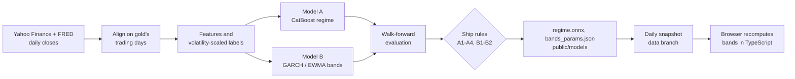

# Paun forecast models

**How Paun's gold forecast is built: two small models trained from scratch on public market data, with the preparation, evaluation and ship rules written down.**

| | |
|---|---|
| Models | Model A: CatBoost regime classifier. Model B: GARCH / EWMA price bands |
| Pretrained or fine-tuned model | None. Nothing in the forecast starts from someone else's weights |
| Training | Offline in Python (`ml/paun_ml`), about a minute on a laptop CPU, no GPU |
| Walkthrough | [`ml/colab.ipynb`](colab.ipynb), generated by [`ml/tools/make_notebook.py`](tools/make_notebook.py) |
| Latest measured results | [`ml/reports/latest.md`](reports/latest.md) (generated 2026-10-06) |

---

## Contents

- [What the models answer](#what-the-models-answer)
- [Trained from scratch](#trained-from-scratch)
- [How it works](#how-it-works)
  - [1. Data](#1-data)
  - [2. Cleaning](#2-cleaning)
  - [3. Features](#3-features)
  - [4. Labels](#4-labels)
  - [5. Model A: regime classifier](#5-model-a-regime-classifier)
  - [6. Model B: price bands](#6-model-b-price-bands)
  - [7. Evaluation](#7-evaluation)
  - [8. Ship rules and the latest verdict](#8-ship-rules-and-the-latest-verdict)
  - [9. Explaining the model](#9-explaining-the-model)
  - [10. Export and daily snapshot](#10-export-and-daily-snapshot)
- [Tech stack](#tech-stack)
- [Run it](#run-it)
- [Project structure](#project-structure)
- [Limitations](#limitations)

---

## What the models answer

| Product | Question | Model |
|---|---|---|
| Price range | Between which two prices will gold probably be in 5 trading days (P10, P50, P90)? | Model B, volatility bands |
| Regime probabilities | Over the next 5 trading days, how likely is an unusually large fall, a quiet week, or an unusually large rise? | Model A, CatBoost classifier |

Neither predicts an exact price. Gold behaves close to a random walk driven by surprises, so exact-price models only look good in hindsight. A range and a set of probabilities are the honest outputs.

The app currently ships **only the price range**. Model A failed one of its ship rules (see [section 8](#8-ship-rules-and-the-latest-verdict)), so regime percentages are hidden (`regime_shipped` is `false` in `public/data/market-snapshot.json`).

## Trained from scratch

Both models are fitted on our own table of daily closes, from 2010 to 2026.

| Question | Answer |
|---|---|
| Is any model pretrained or fine-tuned? | No. CatBoost starts from random initialisation and learns only from our rows. GARCH and EWMA are volatility formulas whose few parameters are fitted to the same data |
| Is there a neural network? | No |
| Why not a pretrained forecaster (Chronos, TimesFM, Moirai, Kronos)? | Not tried. The notebook lists benchmarking them as a next step. Recent data is the fairest test because older prices may sit in their training sets |
| Why trees and volatility formulas? | About 4,000 noisy daily rows is too little for a deep model. Gradient-boosted trees are the stable choice for small tabular data, and volatility clusters, so a range needs no neural network |
| Where do hosted LLMs fit in? | Not in the forecast. Gemini reads receipts through the API Worker; it is a hosted model we call, not one we trained |

## How it works



| Piece | Runs in | Job |
|---|---|---|
| `paun_ml/data.py` | Python, offline | Download and align the raw series |
| `paun_ml/features.py`, `vol.py` | Python, offline | Features, labels and the shared volatility estimate |
| `paun_ml/train_regime.py` | Python, offline | Train, cross-validate, hold out a year, export ONNX |
| `paun_ml/bands.py` | Python, offline | Fit the band parameters |
| `paun_ml/evaluate.py` | Python, offline | Metrics, charts, the ship verdict |
| `.github/workflows/market-snapshot.yml` | GitHub Actions, Mon-Fri 22:30 UTC | Build the daily snapshot on the `data` branch |
| `src/lib/forecast/` | Browser, TypeScript | Port of the features and bands, parity-tested against the snapshot |

The same package serves training, the daily job and the tests, and its formulas are ported to TypeScript. One shared definition prevents train/serve skew: a model trained on inputs computed one way and fed inputs computed another way.

### 1. Data

No API key is needed. Eight daily series, one row per gold session:

| Column | Series | Source | Why it matters for gold |
|---|---|---|---|
| `xau` | COMEX gold futures `GC=F` | Yahoo Finance | The thing being forecast (spot proxy) |
| `dxy` | US Dollar Index `DX-Y.NYB` | Yahoo Finance | A stronger dollar usually weighs on gold |
| `us10y` | US 10-year yield `^TNX` | Yahoo Finance | Rates compete with gold |
| `real10y` | 10-year TIPS real yield `DFII10` | FRED public CSV | Gold's classic opportunity cost |
| `gvz` | CBOE Gold Volatility Index `^GVZ` | Yahoo Finance | What options traders expect |
| `oil` | WTI crude `CL=F` | Yahoo Finance | Inflation and risk proxy |
| `usdmyr` | USD/MYR `MYR=X` | Yahoo Finance | The ringgit price Malaysians see |
| `sp500` | S&P 500 `^GSPC` | Yahoo Finance | Risk-on or risk-off mood |

The download starts at 2010-01-01. The latest run covers 2010-10-19 to 2026-09-29, which is 4,010 labelled sessions. Downloads retry with a growing delay because Yahoo rate-limits shared cloud IPs.

### 2. Cleaning

Each step is visible as plain pandas in the notebook (section 4).

- **One calendar.** Every series is reindexed onto gold's trading days.
- **Forward-fill only, at most 5 sessions.** This covers holiday gaps. Back-filling would copy the future into the past.
- **FRED lag.** FRED dates a value for the day it measures but publishes it the next morning, so `real10y` is shifted one session.
- **Quality report.** For each series: share missing, longest gap, longest frozen run, and daily moves beyond 6 standard deviations (bad ticks, contract rolls).
- **Burn-in.** The first 200 rows are never trained on, because the EWMA and the 200-day average have not settled.

### 3. Features

Models cannot learn from raw prices: gold at $4,000 and at $1,300 are different scales. Every feature is a return, a ratio or a change, so a pattern from 2012 still means something in 2026. The pipeline builds 24 candidate features in 8 groups; the experiments kept 20.

| Group | Features |
|---|---|
| Momentum | `ret_1d`, `ret_5d`, `ret_20d`, `ret_5d_z`, `ret_20d_z` |
| Trend | `ma20_spread`, `ma50_spread`, `ma200_spread`, `ma20_z`, `ma50_z`, `ma200_z` |
| Volatility | `vol_20d`, `bb_bandwidth`, `sigma_5d` |
| Rates | `us10y_chg_5d`, `real10y_chg_5d` |
| Dollar and FX | `dxy_ret_5d`, `usdmyr_ret_5d` |
| Gold volatility index | `gvz_level`, `gvz_chg_5d` |
| Oscillators (dropped) | `rsi_14`, `bb_pct_b` |
| Risk (dropped) | `oil_ret_5d`, `sp500_ret_5d` |

The `_z` features divide a signal by current expected volatility, so "+2%" means the same in calm and wild markets. Trees split on one column at a time and cannot do that division themselves. Plain-language meanings are in the feature glossary of [`reports/latest.md`](reports/latest.md).

**No lookahead.** A feature at row *t* uses only data up to the close of *t*. `tests/test_features.py` appends future rows and checks that no earlier feature moves, and the notebook repeats the check.

### 4. Labels

Regime means what gold did over the **next 5 sessions** compared with the move expected at the time:

| Class | Rule |
|---|---|
| Bearish Retracement | fell by more than 0.75 x sigma |
| Sideways Consolidation | anything in between |
| Bullish Breakout | rose by more than 0.75 x sigma |

Here sigma is the EWMA forecast (lambda 0.94) of the next 5-session volatility, the same estimate that sizes the price bands. A fixed rule such as plus or minus 1.5% made the class mix follow volatility: wild years were all breakouts, so the model mostly re-learned volatility. Scaling keeps the classes balanced. Today's threshold is published in the snapshot as `forecast.threshold_pct`.

### 5. Model A: regime classifier

CatBoost, three classes, trained on the 20 chosen features. The settings are fixed in [`paun_ml/model_config.json`](paun_ml/model_config.json):

| Setting | Value |
|---|---|
| Loss | MultiClass |
| Iterations | 300, fixed, no early stopping on validation data |
| Learning rate | 0.03 |
| Depth | 4 |
| L2 leaf regularisation | 30 |
| Seed | 42 |

The settings are deliberately humble: shallow trees, strong regularisation and a slow learning rate, because small data and many knobs overfit easily.

**How the config was chosen** ([`reports/experiments.md`](reports/experiments.md)). Candidates were compared on the five walk-forward folds only; the held-out year was opened once, for the winner. A candidate needed to beat climatology in at least 3 of 5 folds, and ties within 0.002 went to the simpler one. Each got a block-bootstrap 90% interval.

| Candidate | Folds beating climatology | Mean gain (log-loss) | 90% interval |
|---|---|---|---|
| C1: original 18 features | 2 of 5 | -0.0034 | [-0.0157, +0.0082] |
| C2: plus volatility-normalised (24) | 2 of 5 | -0.0032 | [-0.0165, +0.0093] |
| C3: minus oscillators and risk (20) | 2 of 5 | -0.0027 | [-0.0167, +0.0102] |
| C4: C5 plus shrink to climatology | 2 of 5 | +0.0042 | [-0.0030, +0.0116] |
| **C5: C3 features, depth 4, L2 30 (chosen)** | **3 of 5** | **+0.0024** | **[-0.0095, +0.0134]** |

Six depth and L2 settings were tried, so the winner's score is mildly optimistic. Read the interval, not the point estimate.

### 6. Model B: price bands

Gold's direction is nearly unpredictable, but its volatility clusters: calm weeks follow calm weeks. So Model B forecasts how far gold can plausibly move, not where it will go.

1. Forecast the variance of the next 5 daily returns, with an EWMA (lambda 0.94) or a zero-mean GARCH(1,1) with Student-t innovations.
2. Divide historical 5-day returns by that forecast spread. These standardised returns look similar in calm and wild periods. Take their 10%, 50% and 90% quantiles.
3. Band = spot x exp(sqrt(5-day variance) x quantile).

Empirical quantiles instead of a bell curve keep fat tails and skew. Held-out year results:

| Method | P10-P90 coverage (ideal 80%) | Pinball loss (lower is better) |
|---|---|---|
| GARCH(1,1) | 75.3% | 0.00998 |
| **EWMA (lambda 0.94)** | **79.4%** | **0.01005** |
| Constant-volatility baseline | 49.8% | 0.01060 |

### 7. Evaluation

```
[ train + 5-fold walk-forward CV ........ ][ 5-row gap ][ final test year (252 rows) ]
```

- **Never shuffled.** Every fold trains on the past and tests on the next unseen stretch.
- **5-row purge gap.** Labels look 5 sessions ahead; without the gap, train and test outcomes would overlap.
- **Baseline is climatology**: always predict the historical class mix. A model has to beat it to be worth anything.
- **Judged on log-loss and calibration, not accuracy.** A model close to climatology mostly answers "sideways", so its accuracy only mirrors the base rate.

| Metric | Meaning |
|---|---|
| Log-loss | Grades the probabilities and punishes confident wrong answers. Lower is better |
| Brier | Mean squared error of the probabilities. Lower is better |
| ECE | Calibration: the gap between "said X%" and "happened X% of the time". 0 is perfect |
| Coverage | Share of outcomes inside the P10-P90 band. Ideal 80% |
| Pinball loss | Quantile-forecast score. Lower is better |

### 8. Ship rules and the latest verdict

The rules live at the top of [`paun_ml/evaluate.py`](paun_ml/evaluate.py). Model A ships only if all A-checks pass.

| ID | Rule | Latest value | Result |
|---|---|---|---|
| A1 | Held-out-year log-loss beats climatology | 1.004 vs 1.009 | Pass |
| A2 | Beats climatology in at least 3 of 5 folds | 3 | Pass |
| A3 | Out-of-fold ECE at most 0.05 | 0.031 | Pass |
| A4 | The 90% block-bootstrap interval of the gain over climatology excludes 0 | lower bound -0.0095 | **Fail** |
| B1 | P10-P90 coverage within 80% plus or minus 5 | 79.4% | Pass |
| B2 | Pinball loss beats the constant-volatility baseline | 0.01005 vs 0.01060 | Pass |

**Verdict (2026-10-06): Model A is not shipped, Model B is.** Model A passes A1 to A3 but its edge cannot be told apart from luck, which is exactly what A4 (added so a model cannot ship on luck) catches. The app therefore shows the price range only and never describes regime percentages as a trading signal.

### 9. Explaining the model

[`paun_ml/explain.py`](paun_ml/explain.py) uses CatBoost's exact TreeSHAP: a baseline plus each input's push equals the model's own output, and a test checks that. The report shows global drivers, direction of effect, a worked explanation of today's forecast, and why the band has its width. It also shows driver stability across folds: the top 5 inputs overlap 68% between folds, and low overlap would mean the model's reasoning changes with the period. SHAP shows what the model leaned on, not what caused gold to move.

### 10. Export and daily snapshot

- **ONNX.** `regime.onnx` runs in the browser with `onnxruntime-web`. Export asserts parity with CatBoost: the latest run's max difference is 1.4e-07 against a limit of 1e-3. CatBoost's ZipMap output is stripped so the browser gets a plain tensor.
- **Contract.** Input `features` is float32 `[N, n_features]` in the order of `model_meta.json`; output `probabilities` is float32 `[N, 3]` (Bearish, Sideways, Bullish).
- **Daily snapshot.** A GitHub Action builds `market-snapshot.json` after the US close and commits it to the `data` branch, never `main`. The browser fetches it and recomputes the bands in TypeScript; `src/lib/forecast` is parity-tested against the committed fallback `public/data/market-snapshot.json`.
- **Retraining** is manual (monthly). Commit `public/models/*`, `ml/models/regime.cbm`, `ml/paun_ml/model_config.json` and `ml/reports/` together, and refresh the app's fallback snapshot from the same Python run.

## Tech stack

| Layer | Choice | Why |
|---|---|---|
| Regime model | CatBoost | Strong and stable on small noisy tabular data, exact TreeSHAP built in |
| Bands | `arch` (GARCH), plain NumPy (EWMA) | Volatility clusters, so a formula beats a neural net here |
| Browser inference | ONNX with `onnxruntime-web` | No server, no serving cost |
| Data | `yfinance`, FRED public CSV | No API keys, so laptop, Colab and CI all run as-is |
| Training environment | Python 3.12, Colab or Kaggle | CPU is enough. Python 3.14 wheels for CatBoost and onnx lag |

## Run it

```sh
cd ml
uv venv --python 3.12 .venv && uv pip install --python .venv/Scripts/python.exe -r requirements.txt
.venv/Scripts/python.exe -m pytest -q                      # offline tests on synthetic data
.venv/Scripts/python.exe -m paun_ml.experiments            # optional: search for a better Model A config
.venv/Scripts/python.exe -m paun_ml.train_regime           # train, evaluate, explain, export (needs internet)
.venv/Scripts/python.exe -m paun_ml.snapshot --out artifacts/market-snapshot.json
.venv/Scripts/python.exe tools/make_notebook.py            # regenerate colab.ipynb after editing the generator
```

Add `--use-cache` to `train_regime` to reuse `artifacts/raw.csv` instead of downloading. To run the notebook in Colab or Kaggle, see [`README.md`](README.md). The test suite has 35 tests (`pytest --collect-only -q`). Running `train_regime` rewrites the model files under `public/models`, so run it on a branch.

## Project structure

```
ml/
  README.md           workspace guide: run, Colab, Kaggle, conventions
  MODELS.md           this file
  colab.ipynb         guided notebook (generated, do not hand-edit)
  tools/
    make_notebook.py  generator for colab.ipynb
  paun_ml/
    data.py           download and align the raw series
    features.py       features and volatility-scaled labels
    vol.py            shared EWMA volatility
    constants.py      horizon, burn-in, label multiplier
    model_config.py   chosen Model A settings (reads model_config.json)
    experiments.py    feature, ablation and regularisation search
    train_regime.py   Model A: train, validate, export ONNX
    bands.py          Model B: GARCH / EWMA price bands
    evaluate.py       metrics, charts, ship rules
    explain.py        SHAP explanations
    snapshot.py       daily snapshot builder
  tests/              pytest suite
  reports/            latest.md, experiments.md, figures/
  models/             regime.cbm
  artifacts/          raw data cache and snapshot output
```

## Limitations

- **Model A has no proven skill.** Its gain over climatology is not statistically distinguishable from zero, and most of its signal is volatility, not direction. It is not shipped.
- **Gold futures stand in for spot.** `GC=F` is a continuous futures series; contract-roll gaps are small against the label threshold but exist.
- **Selection bias.** Six regularisation settings and several feature sets were tried on the same folds, so the chosen configuration is mildly optimistic.
- **Bands are a range, not a promise.** Coverage was 79.4% on one held-out year; a different year can differ.
- **The Kaggle path is untested.** It was written from Kaggle's documented layout.
- **Pretrained forecasters were never benchmarked.** Whether one beats these models on the same data is open.
- **The committed notebook has no saved outputs.** Run it to see the charts; the measured results are in `reports/`.
